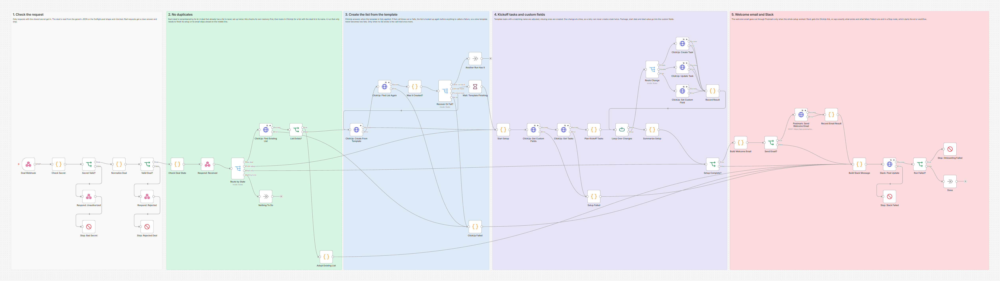
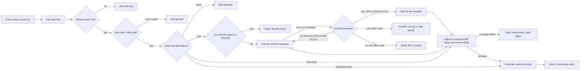

# Won Deal to ClickUp Client Onboarding: n8n + Postmark + Slack

When a deal is marked won in your CRM, this n8n workflow builds the client's onboarding project in ClickUp from your list template, sets the kickoff tasks and custom fields, emails the client a welcome with the kickoff dates and posts the ClickUp link in Slack. It never builds the same project twice.



## The problem

The moment a deal closes, someone has to copy the onboarding template in ClickUp, rename it for the client, fill in the package and start date, assign the kickoff tasks, work out the due dates, write the welcome email and tell the team. It takes 20 to 30 minutes per client, it gets done late on busy days, and small mistakes slip in: a missing assignee, a due date on a Saturday, a welcome email that never went out. When it is automated badly it is worse, because a CRM that sends the same "won" event twice ends up with two projects and two welcome emails.

## What this does

1. **Listens for won deals** from any CRM that can send a webhook. It understands a simple generic JSON format and the payload of GoHighLevel's workflow Webhook action for the "Opportunity Status Changed" trigger. Anything that is not a won deal is answered and ignored.
2. **Checks a shared secret** on every request. A missing or wrong secret is refused, and an empty secret setting refuses everything.
3. **Never builds a project twice.** Every deal is remembered by its id, and before creating anything the workflow also looks in ClickUp for a list with the deal id in its name. Two copies of the same webhook at the same moment still give one project and one email.
4. **Creates the onboarding list from your ClickUp list template**, named after the client, and waits until ClickUp has fully applied the template. If that call times out, it finds the list ClickUp built anyway instead of making a second one. If the call failed and ClickUp has no list, it tries once more.
5. **Sets up the kickoff tasks.** Tasks that the template already has are adjusted (assignees, due date, priority). Missing ones are created. Due dates are counted in business days from the client's start date, in your time zone, and never land on a Saturday or Sunday. Package, start date and deal value are written to the list's custom fields on every kickoff task (ClickUp keeps custom field values per task, not per list).
6. **Emails the client a welcome** through Postmark with the start date and the next steps you choose, but only once the whole setup worked.
7. **Posts to Slack** with the ClickUp link and every kickoff task, or with exactly what exists and what failed.
8. **Finishes the job on a second try.** If a run fails halfway, sending the same webhook again continues on the same list and only does what is missing. If only the email failed, only the email is retried.

## How it works



The webhook answers the CRM as soon as the request is checked (202 accepted, 200 ignored or duplicate, 400 or 401 refused), and the ClickUp work happens after that, so the CRM never waits or times out.

## Workflow at a glance

| Step | Nodes | What it does |
|---|---|---|
| 1 | Deal Webhook | Receives the won deal (POST `/webhook/won-deal-onboarding`) |
| 2 | Check Secret, Secret Valid?, Respond: Unauthorized, Stop: Bad Secret | Compares the shared secret in constant time and refuses anything else with 401 |
| 3 | Normalize Deal, Valid Deal?, Respond: Rejected, Stop: Rejected Deal | Reads the generic or GoHighLevel shape, checks the deal and the workflow settings, works out every date |
| 4 | Check Deal State, Respond: Received, Route by State, Nothing To Do | Looks up the deal in the workflow's memory and decides: new, finish the setup, send the email only, or nothing to do |
| 5 | ClickUp: Find Existing List, List Exists?, Adopt Existing List | Looks for a list with `[deal id]` in its name before creating anything |
| 6 | ClickUp: Create From Template | Creates the list from the template and waits until ClickUp has applied it. The node has no automatic retry, because a blind retry could make a second list |
| 7 | ClickUp: Find List Again, Was It Created?, Recover Or Fail?, Wait: Template Finishing, Another Run Has It, ClickUp Failed | After a failed or timed out call: carries on with the list if ClickUp made it, stops quietly if another run has it, tries once more if there is no list and the call got no answer or a 5xx, or reports that nothing was created |
| 8 | Start Setup, ClickUp: Get Custom Fields, ClickUp: Get Tasks, Setup Failed | Records the list id before anything in the list is changed (n8n stores it when the run ends, also when the run fails), then reads the list's custom fields and every page of its tasks |
| 9 | Plan Kickoff Tasks | Matches the tasks from `KICKOFF_TASKS_JSON` to the template tasks by name and plans each change |
| 10 | Loop Over Changes, Route Change, ClickUp: Create Task, ClickUp: Update Task, ClickUp: Set Custom Field, Record Result | Applies the changes one at a time, so a retry after a 429 never creates a task twice |
| 11 | Summarize Setup, Setup Complete? | Complete only when every change worked |
| 12 | Build Welcome Email, Send Email?, Postmark: Send Welcome Email, Record Email Result | Sends the welcome email and remembers that it went out |
| 13 | Build Slack Message, Slack: Post Update, Run Failed?, Stop: Onboarding Failed, Stop: Slack Failed, Done | Posts the update. Runs that failed end in a Stop node, which starts the error workflow |

## What the team and the client get

A Slack message like this one, taken from the test run (all data made up):

```
:white_check_mark: *Onboarding ready: Harbor Dental Studio*
Deal D-1042 · Growth · $4,800.00 · starts Mon, Mar 4, 2030
ClickUp: <https://app.clickup.com/9012345/v/li/901100000003|Harbor Dental Studio Onboarding [D-1042]>
Kickoff tasks:
• Send welcome packet, due Fri, Mar 1, 2030
• Kickoff call, due Mon, Mar 4, 2030 (from the template)
• Collect logins and brand assets, due Wed, Mar 6, 2030 (from the template)
• Set up CRM pipeline, due Fri, Mar 8, 2030
• Week 1 check-in, due Mon, Mar 11, 2030
Welcome email sent to maya.chen@example.com
```

And the client gets this email (the HTML version has the same content):

```
Subject: Welcome aboard, Maya! Your onboarding starts Mon, Mar 4, 2030

Hi Maya,

Thank you for choosing Acme Growth. We are excited to get started on the Growth package for Harbor Dental Studio.

Your onboarding starts on Monday, March 4, 2030. Here is what happens next:

Monday, March 4, 2030: Kickoff call with your account team
Wednesday, March 6, 2030: Share your logins and brand assets
Monday, March 11, 2030: Week 1 check-in call

Book a time for your kickoff call here: https://calendar.example.com/acme/kickoff

If you have any questions, just reply to this email.

Talk soon,
The Acme Growth team
```

In ClickUp the list is called `Harbor Dental Studio Onboarding [D-1042]`. The deal id in brackets is how the workflow recognizes the list later.

## Setup

**You need:** self-hosted n8n reachable over HTTPS, a ClickUp workspace with a list template, a Postmark account with a confirmed sender, a Slack incoming webhook, and a CRM that can send a webhook when a deal is won.

1. Build your onboarding list in ClickUp with its statuses, views, the kickoff tasks you always have and three custom fields (Package as a dropdown, Start Date as a date, Deal Value as money), then save it as a list template.
2. Import `workflow/won-deal-to-clickup-onboarding.json` into n8n. For failure alerts, also import `workflow/error-alert-slack.json`.
3. Add the variables below to your n8n environment and restart n8n. The nodes read them with `$env`, so self-hosted n8n needs `N8N_BLOCK_ENV_ACCESS_IN_NODE=false`. (n8n Cloud does not allow `$env`. There, replace `$env.` with `$vars.` and create the same names under Variables.)
4. In the workflow settings, choose the error alert workflow as its **Error Workflow**, and activate the error alert workflow too. On n8n 2.19.5 an error workflow that is not active never runs (checked in the tests).
5. Activate the workflow and point your CRM at `https://YOUR-N8N-DOMAIN/webhook/won-deal-onboarding`.

Step by step, including how to find every id and how to set up GoHighLevel: [docs/setup.md](docs/setup.md).

| Variable | Required | Where to find it |
|---|---|---|
| `WEBHOOK_SECRET` | yes | Any long random string you make up. The CRM sends it in the `X-Webhook-Secret` header, or as the custom data key `webhook_secret` in GoHighLevel |
| `CLICKUP_API_TOKEN` | yes | ClickUp → your avatar → Settings → Apps → API Token (starts with `pk_`). Sent as is, without "Bearer" |
| `CLICKUP_WORKSPACE_ID` | yes | The first number after `app.clickup.com/` in any ClickUp link. Used for the list link in Slack |
| `CLICKUP_SPACE_ID` | yes, or the folder | The space that holds the onboarding lists. One API call lists your spaces with their ids: [docs/setup.md](docs/setup.md) |
| `CLICKUP_FOLDER_ID` | no | Set it to keep the onboarding lists in a folder. It is used instead of the space |
| `CLICKUP_TEMPLATE_ID` | yes | The list template id, starting with `t-`. How to list your templates: [docs/setup.md](docs/setup.md) |
| `KICKOFF_TASKS_JSON` | yes | The kickoff tasks, see the table below |
| `CLICKUP_FIELD_PACKAGE`, `CLICKUP_FIELD_START_DATE`, `CLICKUP_FIELD_DEAL_VALUE` | no | Names of your custom fields, default `Package`, `Start Date` and `Deal Value` |
| `CLICKUP_TEMPLATE_TIMEOUT_MS` | no | How long to wait for ClickUp to apply the template, default `90000` |
| `CLICKUP_TEMPLATE_WAIT_SECONDS` | no | After a timeout, how long to let ClickUp finish before the setup continues, default `30` |
| `BUSINESS_TIMEZONE` | no | Your time zone for due dates, for example `America/New_York` (default `UTC`) |
| `DEFAULT_START_BUSINESS_DAYS` | no | Start date when the deal has none: this many business days from today, default `5` |
| `DEFAULT_CURRENCY` | no | Currency when the deal has none, default `USD` |
| `BUSINESS_NAME` | no | Your business name in the welcome email |
| `KICKOFF_BOOKING_URL` | no | A booking link for the kickoff call, shown in the email |
| `POSTMARK_SERVER_TOKEN` | yes | Postmark → Servers → your server → API Tokens |
| `POSTMARK_FROM` | yes | A confirmed Sender Signature or an address on a verified domain, for example `Acme Growth <onboarding@acmegrowth.example.com>` |
| `POSTMARK_REPLY_TO` | no | Where client replies go, for example your account manager |
| `POSTMARK_MESSAGE_STREAM` | no | Postmark message stream, default `outbound` |
| `SLACK_WEBHOOK_URL` | yes | A Slack incoming webhook for the team channel. The error workflow uses it too |

### Kickoff tasks

`KICKOFF_TASKS_JSON` is a list of up to 25 tasks. A task with the same name as a template task adjusts that task; any other name creates a new task.

| Key | Required | Meaning |
|---|---|---|
| `name` | yes | Task name. Matched to template tasks without regard to case |
| `offset_days` | no | Business days from the start date, a whole number from `-120` to `120`. `0` is the start date (the Monday after, if the start date is on a weekend), `-1` the business day before, `5` a week later. Default `0` |
| `assignees` | no | ClickUp user ids (numbers). How to find them: [docs/setup.md](docs/setup.md) |
| `priority` | no | `1` urgent, `2` high, `3` normal, `4` low |
| `description` | no | Task description, for new tasks |
| `in_email` | no | `true` lists this step in the client's welcome email |
| `email_label` | no | The wording the client sees, for example "Share your logins and brand assets" |

A due date that would already be in the past is moved to today (or to Monday, when today is a Saturday or Sunday), and the Slack message says so. The start date itself is kept as the CRM sent it, in the email and in the Start Date field.

### What the CRM sends

Generic JSON, from any CRM, Zapier or Make (only `deal_id`, `status` and `client_name` are required):

```json
{
  "deal_id": "D-1042",
  "status": "won",
  "client_name": "Harbor Dental Studio",
  "contact_name": "Maya Chen",
  "contact_email": "maya.chen@example.com",
  "package": "Growth",
  "deal_value": 4800,
  "currency": "USD",
  "start_date": "2030-03-04"
}
```

`status` counts as won when it is `won`, `closed won`, `closed_won` or `closedwon`. `deal_value` can also be text like `"$1,250.50"`.

GoHighLevel: a workflow with the **Opportunity Status Changed** trigger (filter **Moved To Status** set to Won) and the **Webhook** action pointed at the URL above. The payload already carries the opportunity id, status, value, company and contact. Add three **Custom Data** keys: `webhook_secret` (your secret), `package` and, if you track it, `start_date`. The details are in [docs/setup.md](docs/setup.md).

## Testing

The workflow was tested end to end on n8n 2.19.5 against **mock ClickUp, Postmark and Slack APIs**, so no real account was touched. The mocks answer with the response shapes from the official API docs, and they refuse requests the real APIs would refuse: a wrong or missing token, a "Bearer" prefix on a ClickUp personal token, a list name that is already taken, assignees sent in the wrong format, a custom field value of the wrong type, an unknown dropdown option, a missing Postmark `Accept` header, a sender that is not confirmed, and more. Besides every request, the test reads the deal records n8n keeps in the workflow's static data, so the memory that stops duplicates is checked too.

All 59 checks across 29 scenarios pass in the final run:

| Scenario | Result |
|---|---|
| Wrong secret, no secret | 401, run stopped, no API called |
| `WEBHOOK_SECRET` left empty | Every request refused (fail closed) |
| Deal marked lost | 200 "ignored", nothing created |
| GoHighLevel opportunity lost or abandoned | 200 "ignored" with the status, nothing created |
| Won deal without a deal id | 400 with the reason, nothing created |
| `KICKOFF_TASKS_JSON` broken | 500 without details to the caller, the reason in the failed run |
| Happy path, generic JSON | One list from the template, 2 template tasks adjusted, 3 tasks created with exact due dates (across a daylight saving change), 6 custom field values set, one welcome email, one Slack message. The deal memory holds one small "done" record with the list and Postmark's message id |
| Same won deal sent again | 200 "duplicate", zero API calls |
| GoHighLevel payload | Secret read from custom data, company, contact, value and package mapped, start date defaulted and flagged, a 429 retried without a duplicate task, `&` escaped in Slack and the email HTML |
| List already in ClickUp, no record in n8n | Nothing created or changed, no email, Slack links the existing list and says what to check. Sent again: stopped by the workflow memory |
| ClickUp token rejected | Retried 3 times, Slack alert, no email, run failed. Token fixed and sent again: created normally |
| Template call fails (500) | Tried a second time only after a check found no list, then a Slack alert with the reason, no email |
| ClickUp also down during that check | Both errors reported, no email |
| Template call refused (404, wrong template id) | One try only, a check for the list, then a Slack alert with ClickUp's reason, no email |
| Template slower than the timeout | One template call, the list found again, setup finished on it, one list |
| Template call lost (no answer, no list made) | Checked for the list, tried once more, one list, setup and email done |
| One task cannot be created | Retried 3 times, Slack lists what exists and what failed, no email, the failed change kept in the deal memory. Sent again: only the missing task created, then the email |
| Half finished list deleted in ClickUp (404) | Reported and the deal cleared. Sent again: a new list built from scratch |
| The same, answered with "Team not authorized" (401 OAUTH_027) | Read as a list that is gone, the deal cleared. Sent again: a new list built from scratch |
| ClickUp down while the tasks are read | Retried 3 times, Slack names the step, nothing in the list changed, no email. Sent again with a revoked token: "Token invalid" reported, the deal and its list kept. Sent again with a working token: finished on the same list |
| Postmark refuses the email | Project kept, Slack warns with Postmark's reason, the setup kept in the deal memory for the retry. Sent again: only the email retried, then the deal is "done" |
| No email address, start date today, unknown package, value as text | Project created, past due date moved to today, package left empty with a warning, value read as 1250.5. Email added and sent again: only the email goes out |
| Start date on a Saturday | Every due date on a weekday: the kickoff call moved to Monday with a warning, the other tasks counted in business days, the start date kept in the email and the Start Date field |
| Two copies of the webhook at the same moment | One list with 6 tasks, one email, one Slack message. A third copy afterwards: "duplicate", zero API calls |
| Deal id `constructor` | Built as a new deal, and "duplicate" when sent again (it is not mistaken for a built-in JavaScript property) |
| Slack webhook gone | Project and email done, Slack retried 3 times, run failed with the message in the error |
| Folder template instead of a space | Lists read and created in the folder, with `KICKOFF_TASKS_JSON` still wrapped in the single quotes of the `.env` example |
| Error alert workflow | One Slack alert for each of the 19 failed runs, naming the Stop node and the reason |

Full results and the requests the workflow sent: [docs/test-report.md](docs/test-report.md). Run the same tests yourself with [tests/e2e_mock_test.py](tests/e2e_mock_test.py). What testing and review found and fixed is in [CHANGELOG.md](CHANGELOG.md).

On the test machine, n8n in Docker now and then lost a request on its way to the mocks (about 1 in 400, while other test runs shared the same n8n). Retries covered most of them. A lost template call is the reason the workflow now tries that call once more when ClickUp has no list. When a loss changes a result, the test prints a NOTE that names it. The final run had none. The test report has the numbers.

## What it handles when things go wrong

| Situation | What happens |
|---|---|
| Forged request or wrong secret | 401, nothing is read or created, the run fails so the error workflow alerts you |
| The CRM sends the same deal twice, minutes or months apart | The second one is answered "duplicate" and nothing happens |
| Two copies arrive in the same second | ClickUp refuses the second list name, the second run sees the list and stops quietly |
| ClickUp is down or the token is wrong | No list, no email, a Slack alert with the exact error. Sending the webhook again later works normally |
| The template takes longer than the timeout | ClickUp keeps building it, so the workflow looks for the list and continues on it |
| The template call gets no answer or a 5xx, and ClickUp has no list | Tried once more. If that fails too, Slack gets the reason and no email goes out |
| The template call is refused with a 4xx (wrong template, space or folder id) | No second try, because it would fail the same way. Slack gets ClickUp's reason and no email goes out |
| ClickUp fails while the list's fields or tasks are read | Nothing in the list is changed, Slack names the step, the email waits. Sending the webhook again finishes on the same list |
| ClickUp says 429 (rate limit) on a task | Retried. Changes run one at a time, so the retry only repeats that one change |
| One task or field cannot be saved | The rest is still done, Slack lists what exists and what failed, the welcome email waits. Sending the webhook again finishes only what is missing |
| Someone deleted the half built list | ClickUp answers 404, or "Team not authorized" for an id the token can no longer reach. The deal is cleared and Slack says so. The next webhook looks for a list with the deal id again and, when there is none, builds a fresh one |
| The token is revoked between two tries | Slack shows ClickUp's "Token invalid", and the deal and its half built list are kept, so the next webhook with a working token finishes on the same list |
| ClickUp has a list for the deal that this workflow has no record of | Nothing is changed and no email is sent. Slack links the list and asks the team to check its tasks and send the welcome email by hand if the client has not had it |
| Postmark refuses the email | The project stays, Slack shows Postmark's reason, and sending the webhook again retries only the email |
| The deal has no email address | The project is built, Slack says no email was sent. Add the email in the CRM and send the webhook again to send it |
| A due date would be in the past, or the package is not a dropdown option | The date moves to today, the field is left empty, and Slack lists both as warnings |
| The start date is a Saturday or Sunday | Tasks due on the start date move to the Monday after, with a warning in Slack. The start date in the email and the Start Date field stays as sent |
| Slack is down | The project and email are still done. The run fails with the full Slack text in the error |
| A setting is missing or `KICKOFF_TASKS_JSON` is broken | Nothing is created. The CRM gets a 500 without details, the run fails with the exact setting to fix |

## Limitations and next steps

- The deal memory lives in n8n's workflow static data. n8n saves it as one block per workflow at the end of each run, so two different deals finishing at the same moment can overwrite each other's record. Duplicates are still blocked by the ClickUp name check, but the "finish the job on a second try" record can be lost. At high volume, move the memory to Postgres, Redis or an n8n data table.
- The ClickUp check only looks at active lists in the configured space or folder. A list that was archived or moved elsewhere is not found there (the workflow memory still blocks it).
- Kickoff tasks are matched to template tasks by name. If you rename a task in the template, also rename it in `KICKOFF_TASKS_JSON`, or a second task is created.
- Template task dates are not copied (`old_due_date` is off), because they belong to the day the template was made. Template tasks that are not in `KICKOFF_TASKS_JSON` stay undated.
- Retries after a 429 are safe. After a 5xx or a lost answer, ClickUp or Postmark may have done the work already, so a retry can in rare cases repeat one task or one email.
- If two copies of a webhook arrive in the same second and the template call of one of them fails or gets no answer, that run can take the other run's list for its own. The wait before the setup normally gives the other run time to finish, so its tasks are matched by name and not created again, but the client can get the welcome email twice. It needs both things at once, so it is rare. The same goes for two copies that both arrive while a half finished setup is waiting to be resumed: both runs work on the same list, and a missing task can be created twice.
- When the template call times out, ClickUp keeps building the list, and the workflow waits `CLICKUP_TEMPLATE_WAIT_SECONDS` before it reads the tasks. If ClickUp is still applying the template after that wait, a kickoff task the template also has can be created a second time. Keep `CLICKUP_TEMPLATE_TIMEOUT_MS` generous (the default is 90 seconds) and raise the wait for very large templates.
- Every request with a wrong secret ends in a failed run, so the error workflow posts one alert per request. That is useful for spotting a misconfigured CRM, but a flood of forged requests becomes a flood of alerts. Put the webhook behind a rate limit in your reverse proxy if it is exposed widely.
- A failed run is finished by sending the same webhook again (from the CRM, or by copying the payload from the failed n8n execution). An automatic retry on a schedule would be a natural next step.
- A finished deal is remembered for 400 days (up to 5,000 deals), and there is no button to make the workflow forget one. To build a second project for a deal that is done, send it with a new deal id. Re-importing the workflow clears the whole memory; the ClickUp name check still stops duplicates, but half finished deals then need to be finished by hand.
- Assignees are ClickUp user ids. Mapping the deal owner's email to a ClickUp user would let each deal go to its own account manager.
- GoHighLevel's marketplace `OpportunityStatusUpdate` webhook is not supported: it has no contact email and is signed with GoHighLevel's key instead of a shared secret. Use the workflow Webhook action instead.
- API keys are read from environment variables. For production, move them into n8n credentials so they never appear in the workflow. n8n also keeps webhook payloads in its execution history, including a secret sent as custom data, so set an execution retention period.
- ClickUp allows 100 requests a minute per token on most plans. One deal with the example tasks uses 15. Each kickoff task the template already has costs up to 4 calls (the update and one per custom field) and each new task 1, so a long `KICKOFF_TASKS_JSON` or several deals at once can reach the limit. A 429 is tried 3 times, 2 seconds apart. If it still fails, the deal ends as partly set up and the next webhook finishes it.

## About

Built by **Romiel Inolino**, AI and CRM Automation Specialist working with GoHighLevel, Monday.com, ClickUp, n8n, Make and Zapier.
Portfolio and case studies: [romielwillautomate.dev](https://romielwillautomate.dev)

This repository is a portfolio implementation. Credentials, API keys and customer data are not included, and all test data is made up.
